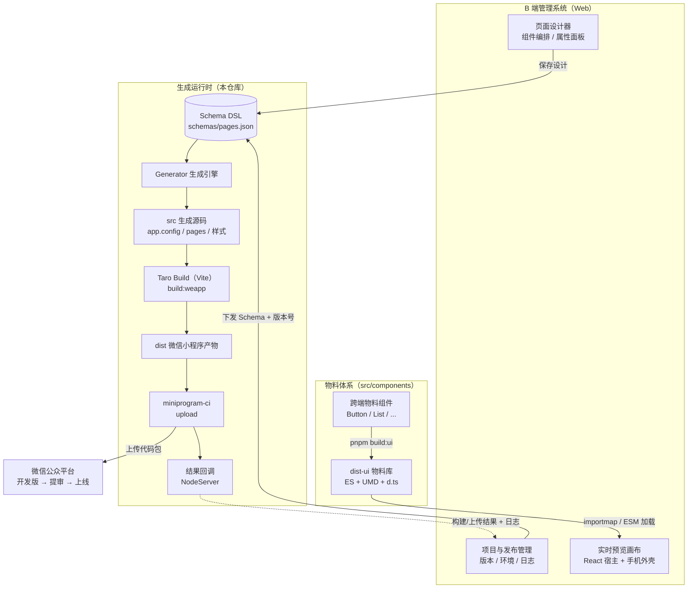
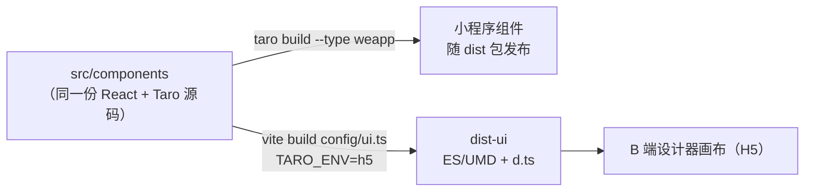
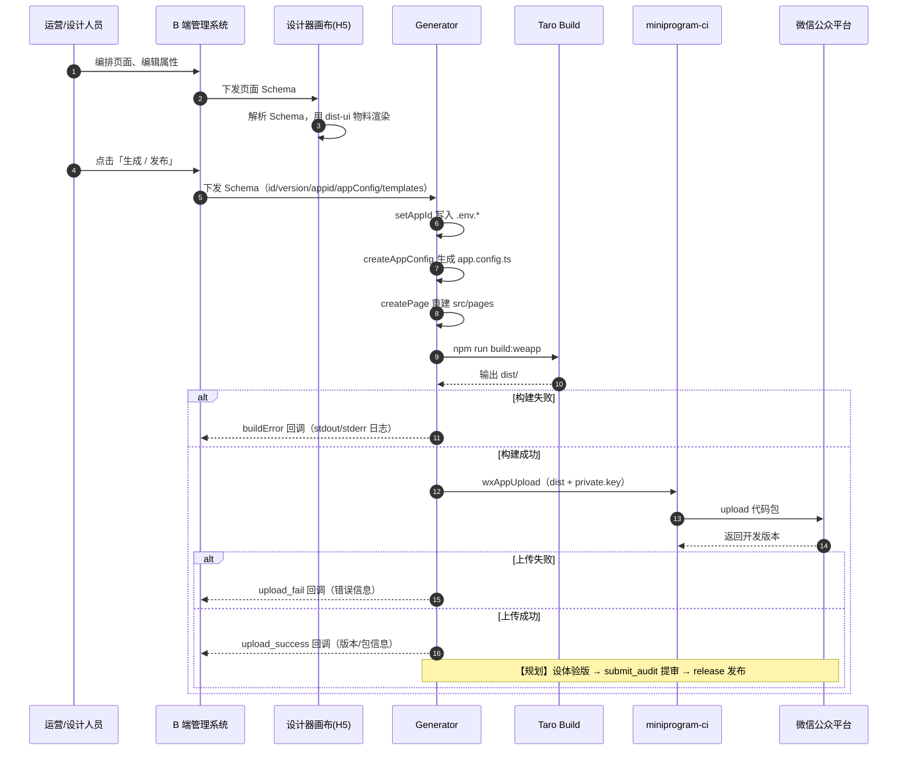
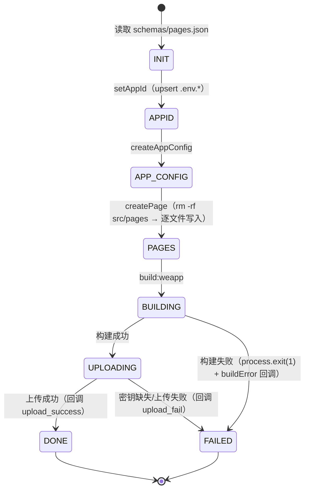
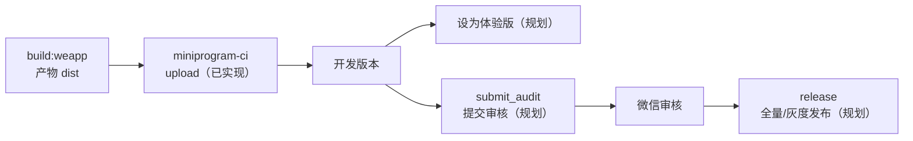

# 小程序设计平台 · 设计标准与规范

> 定位：面向 B 端的小程序可视化设计平台。运营/设计人员在管理系统中**拖拽搭建页面、实时预览、一键生成**，平台自动完成源码生成、Taro 打包、微信 CI 上传，最终提交审核并发布上线。
>
- 底层框架：Taro 4.2（React 18 + TypeScript + Vite + Sass）
- 当前状态：**生成与打包链路已实现**，B 端设计器与自动提审/发布为对接/规划项（文中标注【已实现】/【待对接】/【规划】）

---

## 目录

1. [平台定位与能力边界](#1-平台定位与能力边界)
2. [整体架构](#2-整体架构)
3. [核心流程](#3-核心流程)
4. [技术栈与工程基线](#4-技术栈与工程基线)
5. [目录结构规范](#5-目录结构规范)
6. [Schema 设计规范（DSL 契约）](#6-schema-设计规范dsl-契约)
7. [物料组件规范](#7-物料组件规范)
8. [页面与应用规范](#8-页面与应用规范)
9. [生成引擎规范](#9-生成引擎规范)
10. [构建规范](#10-构建规范)
11. [打包与自动上架规范](#11-打包与自动上架规范)
12. [B 端管理系统对接规范](#12-b-端管理系统对接规范)
13. [环境变量与密钥](#13-环境变量与密钥)
14. [工程质量规范](#14-工程质量规范)
15. [常用命令](#15-常用命令)
16. [规划与扩展](#16-规划与扩展)

---

## 1. 平台定位与能力边界

平台由三端协作构成：

| 端 | 角色 | 说明 |
| --- | --- | --- |
| **B 端管理系统** | 设计器 + 预览 + 发布管理 | 产出页面 Schema，消费物料库渲染画布，触发生成任务并展示结果 |
| **生成运行时（本仓库）** | 生成引擎 + 构建器 + CI 上传 | 读取 Schema → 生成 Taro 源码 → 打包微信小程序产物 → 上传微信平台 |
| **微信公众平台** | 宿主渠道 | 开发版 / 体验版 / 审核 / 上线 |

**职责边界**

- B 端只负责「设计数据（Schema）」与「流程编排」，不直接产出小程序代码。
- 本仓库是唯一的代码生成与构建出口，Schema 是两端之间唯一的契约，禁止通过口头约定或私有接口传字段。
- 物料组件**一次开发，两处运行**：小程序端参与 Taro 编译，H5 端以 `dist-ui` 产物驱动设计器画布。

---

## 2. 整体架构

### 2.1 架构总览



### 2.2 模块职责

| 模块 | 路径 | 职责 |
| --- | --- | --- |
| 应用入口 | `src/app.ts` / `src/app.config.ts` | Taro 应用生命周期与全局配置（由 Schema 生成） |
| 页面 | `src/pages/*` | Schema 生成的业务页面，每次构建**全量重建** |
| 物料组件 | `src/components/*` | 平台内置跨端组件，受版本管理，同时产出物料库 |
| 物料库构建 | `config/ui.ts` | Vite library 模式，输出 `dist-ui`（ES/UMD/类型） |
| Taro 构建 | `config/index.ts` / `dev.ts` / `prod.ts` | 多端编译配置，当前渠道为微信小程序 |
| Schema 契约 | `schemas/pages.json` | 设计器与生成引擎之间的数据协议 |
| 生成引擎 | `generator/core.ts` | `Generator` 生命周期编排、HTTP 工具 `NodeServer` |
| 生成入口 | `generator/index.ts` | CLI 入口：读取 Schema → 生成 → 构建 → 上传 |
| 微信渠道 | `generator/config/wx/` | `miniprogram-ci` 项目配置与上传 |
| 构建回调 | `generator/api/log.ts` | 构建失败等事件回调 B 端（接口地址【待对接】） |

### 2.3 双产物模型

物料组件存在两种编译形态，二者必须保持渲染一致：



- 小程序产物经 pxtransform 按 **750 设计稿**转换 `px → rpx`。
- H5 物料库 external 掉 `react` / `react-dom`，由宿主提供，避免双份 React 导致 hooks/Context 失效。

---

## 3. 核心流程

### 3.1 设计—预览—生成—上架时序



### 3.2 生成引擎生命周期（状态机）



> 当前实现见 [generator/index.ts](file:///Users/kanglu/Downloads/web/小程序/sc-generate-min-program/generator/index.ts)：构建成功后调用 `wxAppUpload`，失败调用 `buildError`。

---

## 4. 技术栈与工程基线

| 类别 | 选型 | 版本/约束 |
| --- | --- | --- |
| 跨端框架 | Taro | 4.2.1，编译器 Vite，框架 React |
| UI 运行时 | React / ReactDOM | ^18（物料库 external，宿主可用 React 18/19） |
| 语言 | TypeScript | ^5.4，`strictNullChecks: true` |
| 样式 | Sass + CSS Modules | `*.module.scss`，750 设计稿 |
| 构建 | Taro CLI + Vite 4 | 多端：weapp/h5/alipay/tt/swan/jd/qq… |
| 微信上传 | miniprogram-ci | ^2.1.x |
| 生成脚本执行 | tsx | 直接运行 `generator/*.ts` |
| 包管理 | pnpm + workspace | Node ≥ 18 |
| 质量 | ESLint / Prettier / Stylelint / Husky / commitlint | 提交前强制校验 |

---

## 5. 目录结构规范

```
sc-generate-min-program/
├── config/                     # 构建配置
│   ├── index.ts                # Taro 基础配置（designWidth/别名/CSS Modules）
│   ├── dev.ts / prod.ts        # 环境差异配置
│   └── ui.ts                   # 物料库 Vite library 构建配置
├── schemas/
│   └── pages.json              # 【契约】页面设计 Schema（唯一数据入口）
├── src/                        # 小程序源码（部分由引擎生成）
│   ├── app.ts                  # 应用入口（版本管理，不被覆盖）
│   ├── app.config.ts           # 全局配置（每次生成时覆盖）
│   ├── app.scss                # 全局样式（版本管理）
│   ├── components/             # 平台内置物料（版本管理，禁止 Schema 写入）
│   │   ├── index.ts            # 物料统一出口（build:ui 入口）
│   │   ├── button/
│   │   └── list/
│   └── pages/                  # 业务页面（每次生成时全量重建）
│       └── home/
│           ├── index.tsx
│           ├── index.config.ts
│           └── index.module.scss
├── generator/                  # 生成运行时
│   ├── index.ts                # CLI 入口
│   ├── core.ts                 # Generator + NodeServer
│   ├── api/                    # 对 B 端的回调 API
│   └── config/
│       └── wx/                 # 微信渠道：upload.ts + private.key（不入库）
├── demo/                       # 物料库宿主集成验证（importmap 示例）
├── dist/                       # Taro 构建产物（gitignore）
└── dist-ui/                    # 物料库产物（gitignore）
```

**写入边界（强制）**

| 目录 | 是否被生成器写入 | 规则 |
| --- | --- | --- |
| `src/pages/` | 是 | 生成前**整目录删除重建**，禁止在其中手工维护代码 |
| `src/app.config.ts` | 是 | 由 `appConfig` 全量覆盖 |
| `.env.*` | 是 | 仅 upsert `TARO_APP_ID`，其他变量保留 |
| `src/components/` | 否 | 平台物料，只允许随仓库版本发布 |
| `src/app.ts` / `src/app.scss` | 否 | 应用壳，版本管理 |
| Schema 自定义组件 | 是 | 统一写入 `src/custom-components/`，**禁止**写入 `src/components/` |

---

## 6. Schema 设计规范（DSL 契约）

Schema 是 B 端与生成器之间的唯一协议，文件位置：`schemas/pages.json`。

### 6.1 顶层结构

```ts
interface ProjectSchema {
    id: string          // 项目唯一标识（B 端项目 ID）
    version: string     // 小程序版本号，语义化 x.y.z，同时作为 upload 版本
    appid: string       // 微信小程序 AppID
    projectName: string // Taro projectName
    appConfig: AppConfig // 对应 Taro defineAppConfig 入参（pages/window/tabBar…）
    templates: TemplateFile[] // 待生成文件描述符列表
}
```

### 6.2 文件描述符 TemplateFile

```ts
interface TemplateFile {
    content: string                              // 文件完整内容（UTF-8 源码文本）
    path: string                                 // 相对 src/ 的路径，如 pages/home/index.tsx
    type: 'page' | 'component' | 'config' | 'style'
}
```

| type | 允许路径 | 典型文件 |
| --- | --- | --- |
| `config` | `pages/**/index.config.ts` | `definePageConfig({...})` |
| `page` | `pages/**/index.tsx` | 页面组件 |
| `style` | `pages/**/*.module.scss` | 页面样式 |
| `component` | `custom-components/**` | Schema 携带的业务自定义组件 |

### 6.3 约束

1. **完整性**：每个页面必须同时包含 `page` + `config`，样式可选但推荐三件套齐备。
2. **路径与路由一致**：`appConfig.pages` 中的路由必须能在 `templates` 中找到对应 `pages/<route>.tsx`，反之不允许存在未注册页面文件。
3. **内容自包含**：`content` 必须是可直接落盘的完整文件，禁止占位符拼接；import 路径按落盘后的真实相对路径书写。
4. **只允许 ASCII 与常规空白**，换行符统一 `\n`，末尾保留一个换行。
5. **版本号**：遵循 SemVer；微信平台同版本号不可重复上传，每次发布必须递增。
6. **向前兼容**：字段只增不删；新增可选字段不得改变既有字段语义；Schema 结构变更须升版本号并在本文件登记。
7. **编码**：JSON 必须可被 `JSON.parse` 解析，`content` 中的换行/引号需正确转义（由 B 端序列化保证）。
8. **校验【待对接】**：生成器落盘前须对 Schema 做结构校验（appid 格式、version SemVer、路由闭合、路径白名单），校验失败直接回调，不进入构建。

最小示例（现状）：[schemas/pages.json](file:///Users/kanglu/Downloads/web/小程序/sc-generate-min-program/schemas/pages.json)。

---

## 7. 物料组件规范

物料位于 `src/components/`，同时服务小程序编译与设计器画布，约束比普通业务组件更严格。

### 7.1 目录与命名

```
src/components/button/
└── index.tsx        # 一个目录一个组件，入口固定 index.tsx
```

- 组件名使用 **PascalCase**，目录名使用 **kebab-case 或小写单词**，与导出名一一对应。
- 统一从 [src/components/index.ts](file:///Users/kanglu/Downloads/web/小程序/sc-generate-min-program/src/components/index.ts) 具名导出：

  ```ts
  export { default as Button } from './button'
  ```

- 单一职责：一个组件只解决一类交互；单文件 **不超过 600 行**，超出必须拆分。

### 7.2 跨端与可渲染性

1. 只允许使用 `@tarojs/components` 提供的跨端基础组件与 `@tarojs/taro` 的跨端 API，禁止直接使用 `wx.*`、DOM `document`/`window`。
2. 组件需要同时在**小程序**与 **H5（画布）**正确渲染；涉及端差异时用 `process.env.TARO_ENV` 收敛分支。
3. 渲染期保持纯净：不得在 render/函数体中发起请求或写副作用；副作用放入 `useEffect` / 事件回调，保证画布可以安全地反复渲染。
4. 跳转、登录、支付等**宿主能力**必须通过 Taro API（`Taro.navigateTo` 等）或 props 回调实现，使画布可用 mock 函数接管。

### 7.3 Props 契约（设计器可消费）

1. 所有 props 必须可被 JSON 序列化（`string | number | boolean | null | object | array`），禁止传入函数、类实例、ReactNode 以外的非序列化结构；事件类交互以**配置化动作**（action schema）表达，由运行时解释执行。
2. 每个组件必须导出 **TypeScript Props 类型**与**组件元数据【规划】**（组件名、分组、默认 props、属性面板描述），供 B 端属性面板自动生成。
3. 必填 props 必须给出合理默认值，确保组件「拖进画布即可见」。
4. 禁止在组件内读取环境/全局单例作为渲染输入，一切外部数据经由 props 注入。

### 7.4 样式

1. 优先使用 CSS Modules（`*.module.scss`），类名小驼峰；全局样式只能写入 `src/app.scss`。
2. 尺寸以 **750 设计稿**为基准书写 `px`，由 pxtransform 在小程序端转为 rpx；禁止硬编码 `rpx` 与 `vh` 的混用。
3. 颜色、间距、圆角等设计令牌【规划】统一从主题变量取，支持 B 端主题换肤。
4. 组件根节点必须有稳定的 className 作用域，禁止依赖标签选择器覆盖 Taro 内部结构。

### 7.5 物料库发布

- 构建命令：`pnpm build:ui`，产物输出到 `dist-ui/`：
  - `index.es.js` / `index.umd.js`：供 H5 宿主以 ESM/UMD 加载；
  - `types/`：d.ts 类型声明。
- `react`、`react-dom`（含 `react/jsx-runtime`）为 external，宿主通过 importmap/CDN 提供，参考 [demo/react19.html](file:///Users/kanglu/Downloads/web/小程序/sc-generate-min-program/demo/react19.html)。
- 新增/变更物料后必须在 H5 宿主验证渲染效果，再发布小程序端，保证两端一致。

---

## 8. 页面与应用规范

### 8.1 页面三件套

每个页面由 Schema 生成，固定结构：

```
src/pages/home/
├── index.tsx           # 页面组件
├── index.config.ts     # definePageConfig（标题、导航栏等）
└── index.module.scss   # 页面样式（可选）
```

- 页面路由：`pages/<name>/index`，与目录、`appConfig.pages` 严格一致。
- 页面配置示例：

  ```ts
  export default definePageConfig({
      navigationBarTitleText: '首页',
  })
  ```

  `definePageConfig` / `defineAppConfig` 为 Taro 编译期全局函数，**不要 import**。

### 8.2 全局配置

- `src/app.config.ts` 由引擎根据 `schema.appConfig` 整体生成，形如：

  ```ts
  export default defineAppConfig({
      pages: ['pages/home/index'],
      window: { /* … */ },
  })
  ```

- `src/app.ts` 为应用壳，负责全局生命周期与全局样式引入，不由 Schema 生成；全局请求、埋点等横切能力在此收敛。

### 8.3 代码风格

- 函数组件优先；页面/组件 props 显式定义类型。
- 组件引用物料使用 `@/components` 别名或相对路径，全仓库风格统一。
- 生成内容必须能通过仓库的 ESLint / TypeScript / Stylelint 校验——**B 端代码生成器需内置同样的格式化规则**，避免「生成即报错」。

---

## 9. 生成引擎规范

核心实现：[generator/core.ts](file:///Users/kanglu/Downloads/web/小程序/sc-generate-min-program/generator/core.ts)。

### 9.1 Generator 生命周期

`Generator.generate(callback)` 严格按以下顺序执行，任一步失败即终止并回调：

| 步骤 | 方法 | 输入 | 输出/副作用 |
| --- | --- | --- | --- |
| 1 | `setAppId()` | `schema.appid` | upsert 三个 `.env.*` 中的 `TARO_APP_ID` |
| 2 | `createAppConfig()` | `schema.appConfig` | 覆盖 `src/app.config.ts` |
| 3 | `createPage()` | `schema.templates` | 删除 `src/pages/` 后按 `path` 落盘全部文件 |
| 4 | `build()` | - | `execSync('npm run build:weapp')`，产物在 `dist/` |
| 5 | 回调 | 状态 | `{ status: boolean, message? }` |

约束：

1. 生命周期顺序不可调换；新增阶段（如 Schema 校验、sourcemap 上传）必须显式插入并在本文档登记。
2. 落盘文件前必须递归创建目录；写入只允许发生在[第 5 节](#5-目录结构规范)定义的白名单路径内。
3. 构建失败必须透出 `stdout/stderr`（已实现），错误信息需可定位到具体文件与行号。
4. 构建进程失败时退出码非 0，便于 CI 判定任务失败。

### 9.2 NodeServer（HTTP 回调工具）

- 统一的 HTTP 客户端，Promise 化，默认 5s 超时、`Content-Type: application/json`。
- 仅允许调用 B 端在环境变量中配置的白名单域名，禁止 Schema 携带回调地址（防 SSRF）。
- 回调需带签名（见 [12.3](#123-鉴权与签名)）与超时重试（建议最多 3 次指数退避）。

### 9.3 渠道扩展

微信渠道逻辑收敛在 `generator/config/wx/`；接入新渠道（支付宝、抖音等）时：

1. 新建 `generator/config/<channel>/`，实现与 `wxAppUpload` 同签名的上传函数；
2. Schema 增加渠道标识与渠道配置，构建命令切换为对应 `build:<channel>`；
3. `generator/index.ts` 按渠道编排，不在 `core.ts` 中写渠道分支。

---

## 10. 构建规范

Taro 配置：[config/index.ts](file:///Users/kanglu/Downloads/web/小程序/sc-generate-min-program/config/index.ts)。

| 项 | 约定 |
| --- | --- |
| `sourceRoot` / `outputRoot` | `src` / `dist`（与 miniprogram-ci 的 `projectPath` 一致） |
| `designWidth` | 750 |
| 路径别名 | `@` → `src` |
| CSS Modules | 小程序/H5 均开启，`[name]__[local]___[hash:base64:5]` |
| pxtransform | 小程序端开启，H5 物料按浏览器规则渲染 |
| 框架/编译器 | React + Vite |
| H5 生产 | `legacy: true`（兼容低版本 WebView） |
| 插件 | `@tarojs/plugin-generator` |

- `project.config.json` 中 `miniprogramRoot` 固定为 `./dist`；本地 `appid` 可为 `touristappid`，真实 AppID 以 `.env` 与 Schema 注入为准。
- 所有构建必须在**干净工作副本**语义下执行：`src/pages` 重建、`dist` 由 Taro 负责清理，禁止依赖上次构建的残留文件。

---

## 11. 打包与自动上架规范

### 11.1 发布阶段模型



| 阶段 | 能力 | 状态 |
| --- | --- | --- |
| 构建打包 | Taro 输出微信小程序产物 | 【已实现】 |
| 上传代码包 | `miniprogram-ci` `ci.upload` | 【已实现】[upload.ts](file:///Users/kanglu/Downloads/web/小程序/sc-generate-min-program/generator/config/wx/upload.ts) |
| 体验版/提审/发布 | 微信服务端 OpenAPI（需 access_token） | 【规划】建议由 B 端后端持有 token 并编排 |

> 说明：`miniprogram-ci` 仅负责把 `dist/` 上传为**开发版本**；提审与发布走微信公众平台服务端接口，需要项目 access_token 与审核类目素材，不应把账号密钥下发到生成运行时。

### 11.2 上传规则

1. 上传前必须校验 `config/wx/private.key` 存在（已实现），缺失时回调错误并终止。
2. `ci.Project`：`appid` 取自 Schema、`projectPath` 为 `dist/`、`type: 'miniProgram'`。
3. `version` 取自 `schema.version`；`desc` 携带构建信息（项目 id、commit、构建时间），便于在微信后台追溯。
4. 上传进度通过 `onProgress` 透传给 B 端展示。
5. 同一版本号重复上传会被微信拒绝，B 端需在发版前做版本递增与占用校验。

### 11.3 运行环境

- 生成/上传任务应在独立 CI Runner 或构建容器中执行，工作目录隔离。
- Runner 需安装 Node ≥ 18、pnpm、依赖与微信小程序上传 IP 白名单配置。
- 构建产物（dist）、日志按项目与版本归档，供 B 端排查。

---

## 12. B 端管理系统对接规范

### 12.1 任务下发

【待对接】推荐两种方式，二选一并长期固定：

- **拉取式（推荐）**：B 端调用 Runner 启动命令并传 `projectId/version/token`，生成器调用
  `GET /api/projects/{id}/schema?version=x` 拉取 Schema，落盘到 `schemas/pages.json` 后执行。
- **下发式**：B 端直接把 Schema 写入 Runner 工作区的 `schemas/pages.json`，再执行 `pnpm generate`。

CLI 入口演进目标：

```bash
tsx generator/index.ts --project <id> --version <x.y.z> --server <apiBase> --token <token>
```

### 12.2 状态回调

生成器在关键节点回调 B 端（由 `NodeServer` 发送，接口地址走环境变量配置）：

| 事件 | 时机 | 载荷 |
| --- | --- | --- |
| `build_failed` | Taro 构建失败 | projectId、version、错误日志（含文件/行号） |
| `upload_success` | CI 上传成功 | projectId、version、CI 返回包信息 |
| `upload_failed` | 密钥缺失/上传失败 | projectId、version、错误信息 |
| `audit_*` / `released` | 【规划】提审与发布 | 审核单 id、状态、拒绝原因 |

- 当前 `buildError` 回调地址为空字符串，对接时在环境变量中补齐，禁止硬编码到代码或 Schema。
- 回调必须幂等（携带 eventId），B 端按事件更新发布状态机。

### 12.3 鉴权与签名

- Runner → B 端：请求头携带短期 Token（环境变量注入），建议 HMAC 签名体 + 时间戳防重放。
- B 端 → 微信 OpenAPI：access_token 仅允许存在于 B 端后端，生成运行时不接触小程序 `secret`。

### 12.4 实时预览

- 设计器画布以 React 为宿主，通过 importmap 提供 react/react-dom 与 `@tarojs/components`、`@tarojs/taro`，ESM 加载 `dist-ui/index.es.js`（参考 demo）。
- 画布拿到 Schema 后按组件名映射物料、按 props 渲染；动作类 props（跳转/请求）由画布 mock。
- 物料升级时通过 package 版本号灰度，B 端锁定物料版本，避免画布与线上小程序渲染漂移。
- 真机预览【规划】：构建后生成开发版二维码回传 B 端，供微信扫码体验。

---

## 13. 环境变量与密钥

| 变量/文件 | 用途 | 管理方式 |
| --- | --- | --- |
| `.env.development` / `.env.test` / `.env.production` | `TARO_APP_ID` 等 | 入库模板；`TARO_APP_ID` 由生成器 upsert |
| `config/wx/private.key` | 微信代码上传密钥 | **禁止入库**，由 CI 密钥管理下发，文件权限 600 |
| `B 端 API 地址 / Token` | Schema 拉取与结果回调 | CI 环境变量注入，不写入代码与 Schema |
| 小程序 `secret` / access_token | 提审发布 | 仅 B 端后端持有 |

- `.gitignore` 必须覆盖：`dist/`、`dist-ui/`、`**/private.key`、本地 `.env.local`。
- 日志与错误信息中禁止打印密钥、Token、请求签名。

---

## 14. 工程质量规范

1. **代码风格**：Prettier + ESLint（`eslint-config-taro`、react-hooks 规则）+ Stylelint；缩进 4 空格、单引号、无分号（以仓库配置为准）。
2. **提交规范**：Conventional Commits，由 commitlint + Husky `commit-msg` 钩子强制；建议格式 `feat(generator): ...`。
3. **提交前检查**：lint-staged 对暂存文件执行 lint/格式化。
4. **类型约束**：新增公共类型必须显式导出；Schema、Generator Options、组件 Props 是三类必须维护的核心类型。
5. **生成代码同样受约束**：B 端产出的模板代码需在生成后通过本仓库 lint/typecheck，建议生成器在 build 前内置快速校验步骤【规划】。
6. **错误可定位**：所有失败回调必须包含项目 id、版本、阶段（build/upload/audit）、可读信息；编译错误透出原始文件路径与行号。

---

## 15. 常用命令

```bash
# 安装依赖
pnpm install

# 执行生成（读取 schemas/pages.json → 生成源码 → 构建微信包 → CI 上传）
pnpm generate

# 小程序构建 / 监听
pnpm build:weapp
pnpm dev:weapp

# H5 等其他端
pnpm build:h5
pnpm dev:h5

# 构建物料库（ES + UMD + 类型），供 B 端画布使用
pnpm build:ui
```

物料宿主验证：直接在浏览器打开 `demo/react19.html`（构建过 `dist-ui` 后）。

---

## 16. 规划与扩展

| 方向 | 内容 |
| --- | --- |
| Schema 治理 | JSON Schema 校验文件、版本字段 `schemaVersion`、变更登记与自动化测试 |
| 设计器闭环 | 组件元数据（属性面板/物料分组/主题令牌）、动作编排协议、物料版本锁定 |
| 发布自动化 | 体验版、`submit_audit`、审核轮询、灰度/全量发布接入 B 端状态机 |
| 多端渠道 | 支付宝/抖音/H5 渠道构建与上传适配，按 Schema 渠道配置编排 |
| 生成器工程化 | CLI 参数化、任务队列与并发隔离、构建缓存、sourcemap 与产物归档 |
| 可观测性 | 构建日志结构化、上传成功率/耗时指标、失败告警 |

---

_本文档随平台演进而更新；任何涉及 Schema、目录写入边界、发布流程的变更，必须先修订本规范再落地代码。_
